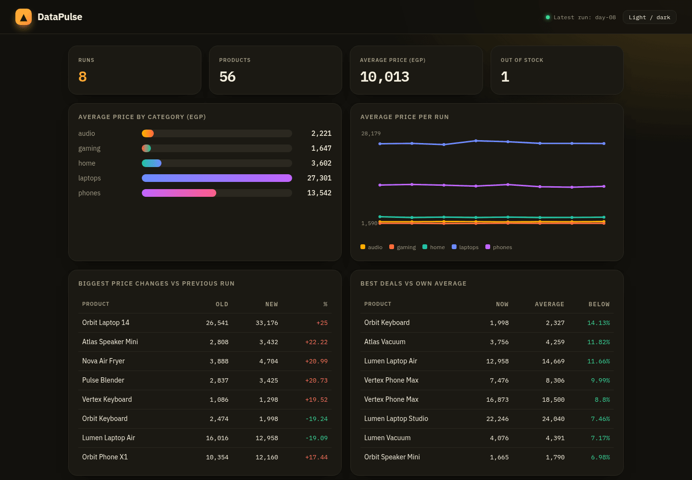

# DataPulse



A price-monitoring pipeline: crawl a shop, clean the data, load it into a SQLite warehouse, analyse price movement, and publish the results as a web dashboard and an Excel report.

The crawl target is a small shop that ships with the project (`datapulse/fixture.py`), so everything runs offline and nothing real is scraped. Point `--url` at another site only if you have permission to crawl it. The crawler checks `robots.txt`.

## Pipeline

1. **Crawl** (`crawler.py`): category discovery, pagination, retries with exponential backoff on 5xx and network errors (no retry on 4xx), robots.txt rules, optional delay between requests, product-page enrichment (rating, stock count).
2. **Parse** (`parse.py`): standard-library HTML parser for listing cards and product pages.
3. **Clean** (`clean.py`): prices in mixed formats (`1,299.00 EGP`, `EGP 1,299`, Arabic digits and separators) to integer piasters, availability to true/false/unknown, name whitespace, de-duplication. Rows that cannot be cleaned go to a rejects table with the reason instead of being dropped silently.
4. **Warehouse** (`warehouse.py`): `runs`, `products`, `prices` (one row per product per run), `rejects`. A run loads in one transaction; loading the same label again replaces that run.
5. **Analytics** (`analytics.py`): summary, category stats (min, median, mean, max), price changes against the previous run, new and removed products, price history, volatility (coefficient of variation), deals versus a product's own average, z-score outliers within a category, category trend.
6. **Outputs**: web dashboard (`dashboard.py`, JSON API plus a single page with SVG charts, search and per-product history) and an Excel workbook (`report.py`) with eight sheets and native charts.

## Quick start

```bash
python -m venv .venv && . .venv/bin/activate
pip install -r requirements.txt

python -m datapulse demo --db datapulse.db --days 6   # simulate six daily crawls
python -m datapulse changes --db datapulse.db         # price moves of 5% or more
python -m datapulse report --db datapulse.db --out report.xlsx
python -m datapulse serve --db datapulse.db           # http://127.0.0.1:8080
```

Crawl a running shop yourself:

```bash
python -m datapulse fixture --port 8099 --day 0 &
python -m datapulse crawl --url http://127.0.0.1:8099 --label 2026-01-01
```

## Tests

```bash
pytest
```

44 tests cover price and stock cleaning, the parser, the crawler (pagination, retries, 404 handling, robots.txt), warehouse transactions and re-loads, every analytics query, the Excel workbook, the dashboard API (including a SQL-injection check) and the CLI.

## Layout

```
datapulse/
  fixture.py   local demo shop with uneven markup and a flaky mode
  crawler.py   fetching, retries, robots.txt, pagination
  parse.py     HTML extraction
  clean.py     normalisation
  warehouse.py SQLite schema and loading
  analytics.py queries
  report.py    Excel report
  dashboard.py web dashboard and JSON API
  pipeline.py  crawl-to-warehouse glue and the demo run
  cli.py       command line
tests/
```
